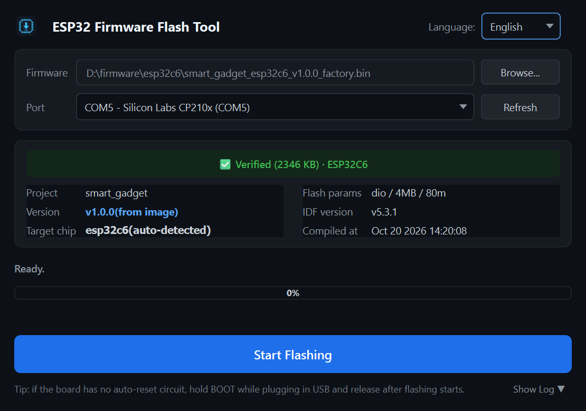

# ESP32 Flash Tool

**English | [简体中文](README.zh-CN.md)**

One-click ESP32 firmware flashing for testers and production staff.
**No ESP-IDF, no Python, no build system required** — plug in the device,
pick the firmware and the serial port, press one button. The tool
auto-detects the chip, refuses mismatched firmware, flashes via esptool,
and confirms the device boots with the expected version.

[](LICENSE)


<p align="center">
  
</p>

## Download

Testers on Windows: grab the prebuilt `ESP32FlashTool.zip` from
[Releases](../../releases) (unzip the whole folder and run — nothing to
install). For running from source, see below.

## Features

- **Product-agnostic**: window title and firmware info adapt to whatever
  firmware is selected;
- **Single firmware entry**: one "Browse..." button dispatches automatically —
  - pick a release-directory `manifest.json` → full anti-fault checks
    (file existence, size, SHA256, embedded version);
  - pick a bare app `.bin` inside an IDF build directory (e.g.
    `build/xxx.bin`) → the bootloader and partition table are read from the
    sibling `flasher_args.json`/`flash_args` and written in one pass at
    their proper offsets — no manual merge step;
  - pick a merged factory `.bin` → chip/version/project auto-detected from
    the image header (manual chip choice only needed for v0 headers without
    chip id), plus image-header validation;
  - pick a bare app image with no boot components (would not boot) →
    rejected with a plain-language explanation;
- **Firmware info panel**: project, version, compile time, ESP-IDF version,
  flash mode/size/frequency (frequency decoded per chip, matching esptool) —
  all parsed directly from the firmware file;
- **Bilingual UI (Chinese/English)**: follows the system language by default,
  switchable in-app (Language), choice persisted;
- **One-click pipeline**: chip detect → flash → reset & verify, fully GUI;
- **Chip guard**: the connected chip is identified before flashing and
  mismatched firmware is refused;
- **Result confirmation**: after flashing the device is reset and the boot
  log captured; "success" only shows when the reported version matches;
- **Single progress display**: write progress lives on the window progress
  bar, keeping the log readable;
- **Baud fallback**: 921600 by default, automatic retry at 115200;
- **Log retention**: full flashing output and device boot log stay in the
  window, ready to copy and report. The log area is collapsed by default to
  keep the UI clean, auto-expands on failure for evidence, and remembers a
  manual toggle;

## UI Flow

```
Pick firmware (dir or .bin) ──► Pick serial port ──► [Start Flashing]
   Step 1: detect the chip
   Step 2: flash (window progress bar)
   Step 3: reset and verify boot
✅ Success — device booted, version vX.Y.Z verified
```

## Requirements (running from source)

| Item | Notes |
| :--- | :--- |
| OS | Windows 10/11 (recommended), Linux, macOS |
| Python | 3.10+ (source runs only; the shipped exe needs nothing) |
| Dependencies | `PySide6`, `pyserial`, `esptool` |

```bash
pip install PySide6 pyserial esptool
```

> Drivers: chips with native USB-Serial/JTAG (e.g. ESP32-C6/S3) need no
> driver on Windows 10+; boards with an external USB-UART (CH340/CP210x)
> need the matching driver.

## Usage

```bash
git clone https://github.com/yakemozu/esp32-flash-tool.git
cd esp32-flash-tool
python3 flash_tool.py                    # empty UI, pick firmware manually
python3 flash_tool.py --manifest-dir /path/to/release/dir   # optional pre-load
```

1. **Pick firmware**: click "Browse..." —
   - select the `manifest.json` of a release directory (recommended, most
     anti-fault checks, includes release traceability info);
   - or select an app `.bin` inside an IDF build directory (e.g.
     `build/xxx.bin`) — the tool picks up the sibling bootloader and
     partition table automatically;
   - or select a single merged `.bin` (via `merge_bin`) — chip and version
     are auto-detected;
2. Connect the device over USB;
3. Click "Refresh" and pick the serial port (use the port number to tell
   multiple devices apart);
4. Click "**Start Flashing**" and wait for the three-step flow;
5. ✅ at the top means success; on ❌ save the log area content and hand it
   to the developer.

> If the board has **no auto-reset circuit**: hold the BOOT button, plug in
> USB, and release BOOT once flashing starts.

## Release Directory Format (optional, enables full anti-fault checks)

A release directory contains:

| File | Purpose |
| :--- | :--- |
| `manifest.json` | version, target chip, factory image file name, SHA256 (required) |
| `<name>_factory.bin` | single merged image from `esptool merge_bin` (required) |
| `flasher_args.json` | flash mode/size/frequency (optional; chip defaults otherwise) |

`manifest.json` example:

```json
{
  "project": "myapp",
  "target": "esp32c6",
  "version": "1.2.3",
  "factory_bin": "myapp_esp32c6_v1.2.3_factory.bin",
  "factory_sha256": "<sha256 of the factory image>",
  "factory_size_bytes": 2402304
}
```

How to produce these files at release-build time:

```bash
# in the IDF build dir: merge the individual bins into one factory image
esptool.py --chip esp32c6 merge_bin -o myapp_esp32c6_vX.Y.Z_factory.bin \
    --flash-mode dio --flash-size 4MB --flash-freq 80m @flash_args
# also generate manifest.json (sha256, version, build time)
```

> **Single-.bin manual mode**: the .bin must be a complete merged image
> (flashed from offset 0x0); if you pick a bare app `.bin` from an IDF build
> directory, the tool auto-includes the sibling bootloader/partition table.

## Troubleshooting

| Symptom | Cause & fix |
| :--- | :--- |
| Serial port list is empty | Driver missing / charge-only cable; change cable or install driver, then "Refresh" |
| Step 1: "no chip detected" | Not in download mode: retry directly if the board has auto-reset; otherwise hold BOOT while plugging USB |
| Step 2 fails and the retry fails too | Change USB port (avoid unpowered hubs/docks), change cable; record the log if it persists |
| Step 3: "device did not boot" | Usually a port-release timing issue — run once more; if persistent, check the firmware itself |
| "chip mismatch, flashing aborted" | Firmware doesn't match the board (in manual mode check the "Target chip" selection) |
| Antivirus flags the exe | Common PyInstaller false positive — whitelist it |

## Packaging a Standalone Executable (for tester distribution)

Tester machines need no Python. **The exe must be built on Windows**
(PyInstaller cannot cross-compile):

Option 1 (recommended): double-click `build_exe.bat` — installs deps and
builds automatically.
Option 2, manually:

```bat
pip install PySide6 pyserial esptool pyinstaller
pyinstaller --noconfirm --clean ESP32FlashTool.spec
```

- Output: `dist\ESP32FlashTool\ESP32FlashTool.exe` — distribute the **whole
  folder** zipped (onedir mode: fast start, fewer antivirus false positives;
  firmware is NOT bundled, testers load it via the "Browse..." button);
- The spec explicitly collects esptool 5.x flasher stub data files;
  after the first build, verify a full flash cycle on a clean Windows PC
  without Python;
- For debugging, flip `console=False` to `True` in the spec to see Python
  tracebacks.

## Repository Layout

```
esp32-flash-tool/
├── flash_tool.py        # entry point
├── gdflash/
│   ├── assets/          # icons and UI vector graphics
│   ├── assets.py        # icon loader and desktop tray/taskbar integration
│   ├── esptool_job.py   # esptool command construction, worker threads, chip detection, progress parsing
│   ├── gui.py           # PySide6 classic standard main window
│   ├── gui_minimal.py   # PySide6 modern minimal card-based main window (default)
│   ├── i18n.py          # Chinese/English runtime string tables
│   ├── manifest.py      # release manifest loading, artifact verification, manual/build-dir firmware objects
│   └── serialboot.py    # post-flash serial boot-log capture and version comparison
├── ESP32FlashTool.spec  # PyInstaller configuration
├── build_exe.bat        # one-click Windows packaging script
├── requirements.txt     # Python runtime dependencies
├── README.md            # this file
└── README.zh-CN.md      # Chinese README
```

## Implementation Notes

- Flashing is built on `esptool` (v5.x): `python -m esptool --chip <chip>
  write-flash <offset> <file> ...`; written data is SHA-verified by esptool
  itself; build-directory mode emits the same multi-offset command as
  `idf.py flash`;
- Chip names are compared normalized: esptool reports `ESP32-C6` while
  manifests use `esp32c6` — lowercased with `-`/`_` stripped;
- Firmware info parsing needs no manifest: the image header (magic, flash
  params, chip_id) and the `esp_app_desc_t` at offset 0x10000 (auto-adapting
  to 24-byte v1 / 8-byte v0 headers) are read directly and cross-checked
  against `manifest.json`; frequency decoding is per chip (e.g. 0x0 means
  80m on ESP32-C6);
- Boot-log version extraction priority: `App version:` banner → generic
  version number, avoiding banner versions like `ESP-IDF vX.Y.Z`;
- Manual .bin mode: skips manifest SHA256 checks; chip/version come from the
  image header (manual chip choice only for v0 headers) and a valid image
  header at 0x0 is required;
- Build-directory mode: a bare app image plus the sibling
  `flasher_args.json` (or `flash_args`) forms a complete flashable set;
  missing bootloader or partition table degrades to a rejection notice;
- Bare app images are refused because they lack the bootloader the device
  needs to start — use a merged image or the full build directory instead.

## Supported Targets

- Chips: ESP32 / ESP32-S2 / S3 / C3 / C6 / H2 / P4 (whatever esptool can
  identify);
- esptool v5.x, Python 3.10+;
- Firmware sources: release directory (manifest.json), IDF build directory
  (app .bin), merged factory image.

## License & Disclaimer

- **Personal Project**: This is an independent personal open-source project created and maintained by the author in personal time. It is not affiliated with, sponsored by, or representative of any current or former employer or commercial entity, and does not contain any employer's proprietary assets;
- Released under [GPL-3.0](LICENSE). The UI uses [PySide6](https://wiki.qt.io/Qt_for_Python)
  (LGPLv3) and bundles [esptool](https://github.com/espressif/esptool) (GPLv2+);
- Firmware flashing can brick your device — use this tool at your own risk;
- Not affiliated with Espressif Systems; esptool belongs to its original
  authors.

<!-- Doc sync: changes here must be mirrored in README.zh-CN.md -->
