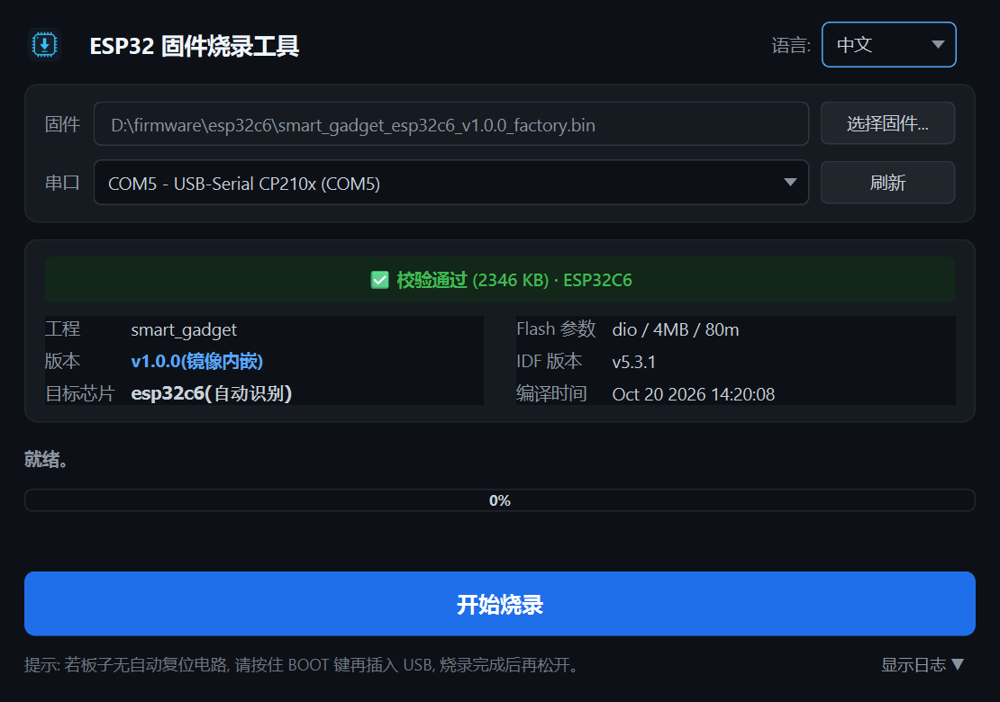

# ESP32 Flash Tool（ESP32 固件烧录工具）

**[English](README.md) | 简体中文**

通用 ESP32 一键烧录工具：插上设备、选择固件和串口、点击一个按钮即可完成烧录，
并自动确认烧录结果。**预编译版本无需安装 ESP-IDF 和 Python**，解压即用。

[](LICENSE)


<p align="center">
  
</p>

## 下载

Windows 测试机请直接到 [Releases](../../releases) 下载打包好的 `ESP32FlashTool.zip`，
解压整个文件夹运行，无需安装任何东西。

## 功能特性

- **单一固件入口，三种来源**：发布目录 `manifest.json`（完整防呆校验）、
  IDF 构建目录 app `.bin`（自动补齐 bootloader 与分区表）、合并工厂 `.bin`；
- **防呆校验**：烧录前校验文件尺寸、SHA256、内嵌版本号及实际芯片匹配；
- **一键流水线**：芯片识别 → 烧录 → 复位启动校验；
- **固件信息面板**：工程名、版本、编译时间、IDF 版本、Flash 参数直接解析自镜像；
- **中英双语界面**，自动跟随系统明暗主题；
- **波特率自适应**：默认 921600，失败自动降级 115200 重试。

## 快速开始

### 源码运行

需要 Python 3.10+。

```bash
pip install -r requirements.txt
python flash_tool.py
```

### 烧录设备

1. 点击"**选择固件...**"，选择以下任意一种：
   - 发布目录中的 `manifest.json`（推荐）；
   - IDF 构建目录中的 app `.bin`；
   - 合并后的工厂 `.bin`。
2. 连接设备，点击"**刷新**"选择串口；
3. 点击"**开始烧录**"，等待三步流程完成；
4. 显示 ✅ 表示设备已启动且版本校验通过；显示 ❌ 时保存日志并反馈给开发人员。

> 若板子**没有自动复位电路**：按住 BOOT 键再插入 USB，烧录开始后松开。

> 驱动说明：原生 USB-Serial/JTAG 芯片（ESP32-C6/S3）Windows 10+ 免装驱动；
> CH340/CP210x 等外接串口芯片需安装对应驱动。

## 常见问题

| 现象 | 处理方法 |
| :--- | :--- |
| 串口列表为空 | 驱动未装 / 线材无数据功能；装驱动或换线 |
| 未检测到芯片 | 未进入下载模式；重试或按住 BOOT 插入 USB |
| 两种波特率均烧录失败 | 换 USB 口（避免无源 Hub）和线材 |
| 设备未启动 | 重跑一次；反复出现需检查固件本身 |
| 芯片型号不符 | 固件与板子不匹配 |
| 杀毒软件拦截 exe | PyInstaller 常见误报，加白名单即可 |

## 详细文档

- [固件发布格式](docs/firmware-format.md) — manifest.json 字段说明及发布目录生成方法；
- [打包与分发](docs/packaging.md) — Windows 独立 exe 构建方法及发布验收清单。

## 支持范围

ESP32 / ESP32-S2 / S3 / C3 / C6 / H2 / P4（由 esptool 5.x 芯片识别决定）。
固件来源：发布目录、IDF 构建目录、合并工厂镜像。

## 许可证与免责

Copyright (C) 2026 MingChuLab

本项目以 [GPL-3.0](LICENSE) 发布。第三方组件许可证及源码获取方式详见 [NOTICE](NOTICE)。

固件烧录存在使设备变砖的风险，使用本工具须自行承担风险。

<!-- 文档同步: 修改本文档时请同步更新 README.md -->
